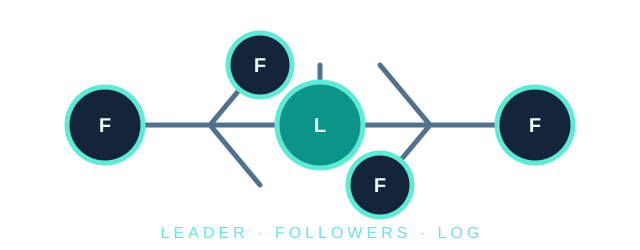

 <p align="center">
  
  <br/>
  
  <br/>
  
  
  
  
  <br/>
  
</p>

## 🧭 Overview

Raft Consensus Lab is a small, deterministic browser simulation that makes the core ideas of leader-based replication visible. Advance logical time, trigger an election, and append a command to see the leader and followers update.

## ✨ Features

- 🗳️ Step through simplified leader elections.
- 💓 See heartbeat activity and term changes.
- 📚 Append a command and replicate it across the cluster.
- 🧪 Reset the simulation to repeat the same scenario.
- 🔒 Runs locally without accounts, uploads, or external libraries.

## 🎬 Demo

Start the local server and use **Tick**, **Append command**, and **Reset**. The interface renders the cluster state and event history live; no hosted demo is claimed.

## 🚀 Quick Start

Requires Node.js 18 or newer.

```bash
npm start
```

Open http://localhost:4173 in your browser.

## 🧰 Tech Stack

- 🟢 Node.js built-in HTTP server
- 🌐 HTML, CSS, and browser JavaScript
- 📦 No third-party runtime dependencies

## 🗂️ Folder Structure

```text
raft-consensus-lab/
├── assets/mark.svg
├── app.js
├── index.html
├── server.js
├── package.json
├── README.md
├── LICENSE
└── .gitignore
```

## 🛣️ Roadmap

- [ ] Add controllable network partitions.
- [ ] Visualize quorum and commit indexes.
- [ ] Add configurable election timeouts.

## 🤝 Contributing

Issues and pull requests are welcome. Keep changes small, explain the behavior being changed, and test the local workflow with `npm start`.

## 📄 License

Released under the MIT License. See [LICENSE](LICENSE).

<p align="center"></p>
